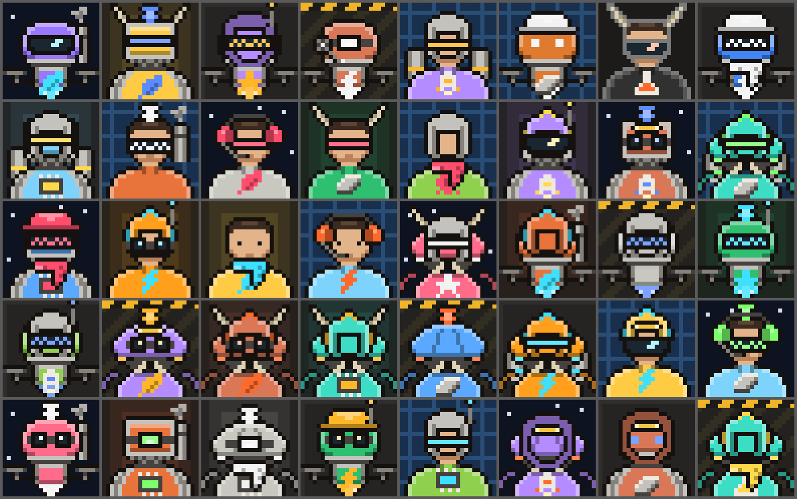
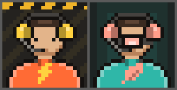
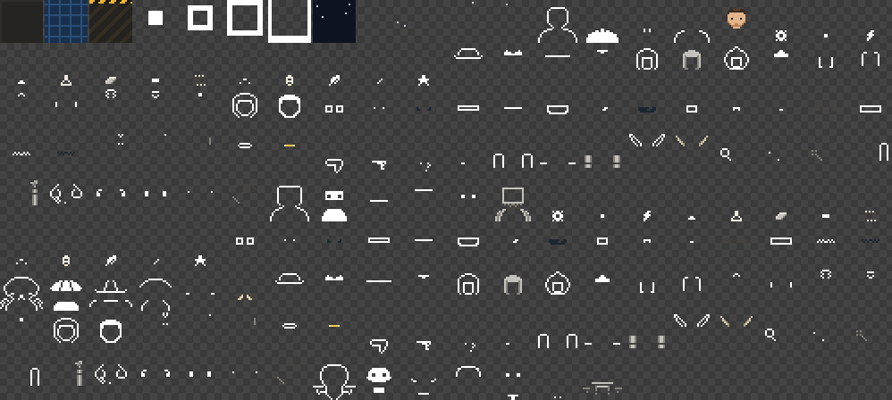
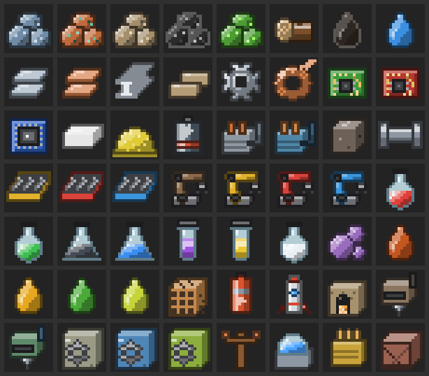

# Agent avatars, item icons and the Factorio UI kit: engineering notes

Branch `eng/art`. Three self-contained pieces for the stream overlay (eng/stream2) and the website (site):

1. Agent-designed pixel-art avatars: an optional `avatar` field on the harness `profile` action, one renderer in
   JS (`tools/stream/static/avatar.js`) with a byte-identical Python port (`tools/stream/avatar.py`), and a gallery
   page (`tools/stream/static/avatars.html`). The casters' portraits are in `tools/stream/static/casters.js`, and
   the parts are exported as Factorio sprite layers with a Lua module in `tools/stream/sprites/`.
2. A Factorio-flavoured CSS kit: `tools/stream/static/factorio-ui.css` with a demo page
   (`tools/stream/static/factorio-ui.html`).
3. Item icons in the same pixel style for the production widget and the site: `tools/stream/static/items.js`
   (SVG lookup by item name), the Python port `tools/stream/items.py`, and a gallery
   (`tools/stream/static/items.html`).

No game image assets, sprites or fonts are copied anywhere. The avatar art is hand-placed pixels on a 24x24 grid;
the item icons are 16x16 grids drawn by a small script from simple shapes plus hand-placed details; the kit is CSS
gradients, borders and shadows plus the free Titillium Web font from Google Fonts.

## Avatars



### What agents send

```sh
./fh call profile --args '{"avatar":{"base":"robot","helmet":"hardhat","visor":"mono","emblem":"gear","accessory":"antenna","backdrop":"hazard","accent":"#33ccff"}}'
```

| Field | Values |
|---|---|
| `base` | engineer, robot, biter, drone |
| `helmet` | none, hardhat, armor, power, crest, hood |
| `visor` | none, goggles, slit, wide, mono, grid |
| `emblem` | none, gear, bolt, flask, plate, circuit, rocket, leaf, star |
| `accessory` | none, antenna, headlamp, scarf, tank, horns, earpiece, pipe, headset |
| `backdrop` | dark, grid, hazard, glow, night |
| `accent` | `"#rrggbb"`, the second colour (hardhat, emblem, glow, visor glint) |

- Every field is optional. The suit is always the profile `color`.
- 4 x 6 x 6 x 9 x 9 x 5 = 58,320 part combinations before colours.
- `headset` (ear cups in the accent colour, band, boom mic; round 3) is the casters' signature. Agents may choose it,
  but it is never drawn as a name-based default (see `picks` below).
- `agent/team.md` (the co-op prompt) now tells agents about it, next to the existing identity line.

### Harness (`vendor/factorio-harness/mod/agent-harness_0.1.0/profiles.lua`)

- `profile` accepts `avatar`: an object whose keys must be the fields above and whose values must come from the
  lists (`accent` must be `#rrggbb`, stored lowercase). Errors name the field and the allowed values, e.g.
  `avatar.base must be one of engineer|robot|biter|drone`, `avatar: unknown field hat`.
- The avatar is validated before anything in the call changes, so a bad avatar leaves `display_name` etc. alone.
- A new `avatar` replaces the old one (no merging). `{}` is valid and means "all parts from my name". `false` clears.
- `profile` and `profiles` return it as `avatar` (absent when unset). The `describe` schema documents it, which also
  makes `avatar` an allowed argument for `check_args`.
- Runtime-only change (one Lua module); `fh deploy` puts it in a running world. No `control.lua` change, so clients
  need no mod refresh.
- `glyph` stays as it was (a 1-2 character tag beside the name). The schema text no longer calls it the avatar.

### Defaults and filling

Renderers, not the harness, fill gaps, so the harness stays a validator and store:

- Seed: 32-bit FNV-1a of the UTF-8 `name` (falls back to `display_name`, then `"agent"`), fed to mulberry32.
- Each field draws one number in a fixed order (`base, helmet, visor, emblem, accessory, backdrop`) whether or not
  it is set, so setting one part never changes the others.
- Name-based picks come from `PARTS.picks[field]` when the field has one, else from `PARTS.options[field]`. A part
  added later goes at the end of `options` only, so it is choosable while every existing default stays exactly as it
  was (checked: 2,009 profiles render identically before and after the headset). `test_avatar.py` requires `picks`
  to be a prefix of `options`.
- No valid `color`: one of 12 palette colours picked from the seed (Sonnet in the shakedown never set a colour).
- No `accent`: the first of 8 Factorio-ish accents (amber, orange, cyan, green, red, white, yellow, blue), starting at
  a seeded index, that differs from the suit by at least 180 (sum of RGB channel differences).
- Invalid parts from an old or hand-edited profile are treated as unset, so a renderer never fails.
- Near-black suits (luma < 0.16, e.g. Grok's `#1a1a1a`) get a light rim instead of a black outline and a slightly
  lifted fill, so they stay visible on the dark backdrops.

### Renderer API

JS (`avatar.js`): no dependencies, works as a classic `<script>` (sets `window.PogAvatar`) or under node
(`require`).

```js
PogAvatar.svg(row, 48)          // SVG string for a `profiles` row {name, display_name, color, avatar}
PogAvatar.svg(row, 32, {title: "Opus"})   // aria-label override
PogAvatar.resolve(row)          // {base, helmet, visor, emblem, accessory, backdrop, color, accent} as drawn
PogAvatar.pixels(row)           // 24 rows x 24 "#rrggbb"
PogAvatar.random(seed)          // a random valid spec
PogAvatar.validate(avatar)      // [] or the harness's error strings
PogAvatar.PARTS                 // part lists, palettes and pixel art
```

The SVG is a 24x24 `viewBox` with `shape-rendering="crispEdges"`, one `<path>` per colour (horizontal runs
merged), about 3-5 KB. It scales cleanly to any size; multiples of 24 (24, 48, 72, 96) look sharpest.

Python (`tools/stream/avatar.py`, stdlib only): the same functions (`svg(row, size, title=None)`, `resolve`,
`pixels`, `random`, `validate`). The part lists and art are read from `avatar.js` (the strict-JSON block between
`/*@parts*/` and `/*@end*/`), so art changes are made once, in the JS file. If you copy the port elsewhere, copy
`avatar.js` with it or pass its path to `_load_parts`.

```sh
python3 tools/stream/avatar.py opus --color '#d97757' --avatar '{"base":"robot"}' --size 96 > opus.svg
python3 tools/stream/avatar.py --profiles profiles.json --out site/static/avatars   # one NAME.svg per row
```

### Adopting it

- Overlay (eng/stream2): `<script src="avatar.js"></script>` in `index.html`, then in `fillAvatar` set
  `a.innerHTML = PogAvatar.svg(agent, size)` instead of the glyph letters. `agent` is the `profiles` row the overlay
  already holds, so `avatar`, `color` and `name` are all there. Add `avatar` to the change signature
  (`a.name + a.color + a.glyph + a.display_name` in `overlay.js`) so a new avatar re-renders. The glyph can stay as a
  small tag beside the name. `mock.py` does not send avatars yet, so the mock shows the name-based defaults.
- Site: `from avatar import svg` (add `tools/stream` to `sys.path`) in `site/build.py` and inline the SVG, or write
  files with the `--profiles` CLI. Run data needs the `profiles` rows (name, color, avatar) saved with the run.

### Casters (`tools/stream/static/casters.js`)



The stream's two hosts get avatar.js portraits like the agents. Today they are caster.py's Rook (play-by-play:
punchy, high energy) and Vale (colour: analysis, warmth, dry humour). eng/audio is reworking them into streamer
hosts, and when this round was drawn its notes had no new names or personalities yet (no commits past main), so the
looks follow the current personas: Rook is an orange engineer with a bolt emblem on the hazard backdrop, and Vale is
a teal engineer with a monocle and leaf emblem on the soft glow backdrop. Both wear the headset.

`casters.js` holds one strict-JSON entry per host, keyed like caster.py's `CASTERS` (`pbp`, `color`):
`{name, role, color, avatar}`. Every part, the colour and the accent are set, and no host uses the `night` backdrop
(its stars follow the name), so the name only feeds the label. So:

- Rename: change `name` in `casters.js` (and in caster.py). The portrait does not change; the test checks this.
- Restyle or add a host: edit or add an entry with any avatar.js parts. The gallery and the Python CLI pick it up.

```js
// <script src="avatar.js"></script><script src="casters.js"></script>
PogCasters.svg("pbp", 48)       // SVG via PogAvatar
PogCasters.row("color")         // {name, display_name, color, avatar, role, kind: "caster"} for PogAvatar.svg
PogCasters.byName("Rook")       // "pbp": for captions that carry only the speaker's name
```

```sh
python3 tools/stream/avatar.py --casters --out site/static/avatars    # Rook.svg, Vale.svg
```

In Python, `avatar.casters()` returns the same rows. Overlay use (eng/stream2): the caption block that shows who
is speaking can put `PogCasters.svg(key, 28)` beside caster lines, the same way agents get theirs.

### Gallery (`tools/stream/static/avatars.html`)

Open the file directly (no server needed). It has:

- A builder: name, colour, accent and one select per part ("from name" = unset), previews at 96/48/32/24 px, the
  resolved spec, and the exact `./fh call profile` command to paste.
- The nine shakedown agents with their chosen colours and no avatar, i.e. what the overlay shows until they pick one.
- The casters from `casters.js` (click one to load it into the builder).
- 40 random valid avatars (Reroll for more; click one to load it into the builder).
- The parts table.

### Tests

- `vendor/factorio-harness/tests/bots.lua` (fake engine, part of `npm test`): set and read back an avatar, accent
  lowercased, replace instead of merge, unknown field, bad value, bad accent, non-object, a refused avatar changes
  no other field, the headset is accepted, `false` clears, `profiles` rows carry it.
- `python3 tools/stream/test_avatar.py`: JS (under node) and Python give identical SVG, `resolve`, `validate` and
  `random` for 273 profiles (random specs, partial/invalid specs, no colour, near-black/white, unicode and escaped
  names); the Lua part lists equal the JS ones; every picture is a full 24x24; defaults are stable and setting one
  part keeps the rest; `picks` is a prefix of `options` and defaults never draw the headset; each caster sets every
  part, is identical in JS and Python, and renders the same pixels under another name; `avatar_sprites.js --check`
  passes (sprite composite equals avatar.js, Lua port equals JS) and the committed sprite files are current.
- `npm test` (round 3): 89 pass. The 4 `bridge.test.ts` cases fail with `listen EPERM` on their unix socket in this
  sandbox, before any test code runs (same as on eng/bots).

### Not verified live

This session's permission mode refused RCON (`bin/fh`) and browser access, so `profile` with an avatar was not run on
world `live`, and the two HTML pages were checked by script (syntax, and the gallery script run against a stub DOM)
but not looked at in a browser. The avatar art itself was checked visually from PNG contact sheets rendered from
`PogAvatar.pixels`. To verify live:

```sh
POG_WORLD=live bin/fh deploy                      # the save may carry an older runtime; repeat if the first call is eaten
tools/pog.py --world live rcon '/silent-command rcon.print(remote.call("agent_harness","bot_create","astra"))'   # if no bot yet
POG_WORLD=live bin/fh --bot astra call profile --args '{"color":"#9977ff","avatar":{"base":"robot","visor":"mono","accent":"#33ccff"}}'
POG_WORLD=live bin/fh --bot astra call profile --args '{"avatar":{"base":"dragon"}}'     # expect: avatar.base must be one of ...
POG_WORLD=live bin/fh call profiles               # astra's row has "avatar":{...}
```

A director client must be connected (or `auto_pause` off) for bots on `live`.

### Sprites for the game (eng/harness2)

For drawing agent avatars above characters with `rendering.draw_sprite`. Generated from `avatar.js` by
`node tools/stream/avatar_sprites.js` into `tools/stream/sprites/`:

- `avatar-parts.png`: an RGBA atlas, 1996x896 px, 174 cells (313 sprites; identical images share a cell).
- `avatar_sprites.lua`: the sprite table plus a Lua port of `resolve` and `palette` and a `layers` function. It is
  generated, so do not edit it. It runs in the data stage and the control stage and calls no game API itself.



**Layers.** Every sprite is a whole avatar canvas: 24x24 avatar pixels at 4 px each, so 96x96 px, with the part
already in place. All layers therefore have the same size and the same anchor (the cell's centre), and an avatar
is drawn by putting its layers at one target with one offset and one scale, bottom to top. A layer is one of two
kinds:

- A white mask (opaque `#ffffff` pixels), named `...-suit`, `-suitdark`, `-suitlight`, `-outline`, `-accent`,
  `-accentdark`, `-accentlight`, `-accentsoft`, `-accentpale`, `-accentglow` or `-glow1..4`. It is drawn with
  `tint` set to one palette colour. Since the mask is white, the tinted pixel is exactly that colour.
- A detail layer (`...-detail`, no tint): the colours that never change (skin, metal, visor glass, backdrop
  patterns).

There is one mask per colour, so shading follows the avatar.js rules exactly. That includes near-black suits, which
get their light rim from the `outline` tint. `--check` composites every layer from the PNG with its tint for 313
profiles (agents, random specs, casters, unicode and empty names) and gets avatar.js's pixels exactly.

Sprite names are `pogav-<base>-<part>-<option>-<paint>` (for example `pogav-robot-helmet-hardhat-accent`) and
`pogav-backdrop-<backdrop>-<paint>`. Parts are exported once per base because helmets, visors, emblems and
accessories sit at different heights on different bases. Night's stars 4-7 are separate sprites because they
follow the name, like the SVG.

**Data stage** (a prototype change: the mod needs `data.lua` and the PNG, so all clients need the new mod version
and the server a restart, unlike `fh deploy`):

```lua
-- data.lua; copy avatar-parts.png to graphics/ and avatar_sprites.lua next to data.lua
for _, p in pairs(require("avatar_sprites").prototypes("__agent-harness__/graphics/avatar-parts.png", 0.5)) do
  data:extend{p}
end
-- each: {type="sprite", name=..., filename=..., x=..., y=..., width=96, height=96, scale=0.5, flags={"no-crop"}}
```

**Control stage:**

```lua
local AV = require("avatar_sprites")
-- row = the profiles row: {name=bot_or_player_name, display_name=..., color=pr.color, avatar=pr.avatar}
local ids = {}
for _, l in ipairs(AV.layers(row, {backdrop = true})) do
  ids[#ids + 1] = rendering.draw_sprite{sprite = l.sprite, tint = l.tint, surface = c.surface,
    target = {entity = c, offset = {0, -3.4}}, x_scale = 1, y_scale = 1}.id
end
```

- `AV.layers(row, opts)` returns `{sprite, tint, hex}` bottom to top (`tint` is `{r, g, b, a}` in 0..1, or nil for
  detail layers), and the resolved spec as a second value. Unset parts, colour and accent come from the name as on the
  overlay, so the in-game avatar matches the stream's. `opts.backdrop = false` leaves out the square backdrop, so
  only the figure is drawn.
- Layer count: 6 to 23 for the figure, plus 1 to 4 for the backdrop. With 9 agents that is up to about 250 render
  objects. Redraw (destroy the ids, draw again) when `profile` changes the avatar, colour or name. Objects targeting
  a character go away when it dies, so draw them again on respawn.
- Size: at `scale = 0.5` the avatar is 48x48 game pixels, 1.5 tiles (each avatar pixel is 2x2 at zoom 1).
  `x_scale`/`y_scale` at draw time resize it, and 2/3 gives a 1-tile avatar. Cells are 4 px apart, so filtering at
  odd zooms does not bleed between neighbours.
- Placement: speech bubbles (`profiles.lua`) draw text from `offset {0, -2.6}` upward. A 1.5-tile avatar centred at
  `{0, -3.4}` sits above the head (-2.65 to -4.15). Either start the bubbles above it (about -4.3) or put the avatar
  beside them (for example `{-1.4, -2.9}` at 2/3 scale). That layout is harness2's call.

**Not verified in Factorio.** No game client was available to this session. The layer maths, atlas placement and
the Lua port are checked offline: the Lua runs under `lua` 5.5 with only double arithmetic, as Factorio's 5.2
needs, and gives the same layers and tints as the JS. Things to confirm in game: the `no-crop` flag and `scale`
look right, pixels stay crisp at the zooms the director cameras use (if they blur, check the sprite filtering flags
in the prototype docs and try whole-number screen scales), and layers stack in the order they are created.

## Item icons



Original 16x16 pixel art in the avatars' style: dark outline from each material's own colour, light from the top
left, flat shading bands. Icons are keyed by the game's internal item names, so the production feed's `item` goes
straight in. 59 icons:

| Group | Items |
|---|---|
| Raw resources | iron-ore, copper-ore, stone, coal, uranium-ore, wood, crude-oil, water |
| Intermediates | iron-plate, copper-plate, steel-plate, stone-brick, iron-gear-wheel, copper-cable, electronic-circuit, advanced-circuit, processing-unit, plastic-bar, sulfur, battery, engine-unit, electric-engine-unit, solid-fuel |
| Logistics | pipe, transport-belt, fast-transport-belt, express-transport-belt, burner-inserter, inserter, long-handed-inserter, fast-inserter |
| Science | the seven packs, automation through space (round flask: red, green, space; conical: military, blue; vial: purple, yellow, so they differ by shape as well as colour) |
| Oil and fluids | petroleum-gas, heavy-oil, light-oil, lubricant, sulfuric-acid (crude-oil and water are under raw) |
| Rocket | low-density-structure, rocket-fuel, rocket-part, flying-robot-frame, satellite |
| Buildings and ammo | stone-furnace, burner-mining-drill, electric-mining-drill, assembling-machine-1/2/3, small-electric-pole, lab, firearm-magazine, piercing-rounds-magazine, stone-wall |

Any other name renders as a crate tinted from a hash of the name, with a label made from the name
("my_modded--thing" -> "My modded thing"), so new items never break a widget.

### API

```js
// browser: <script src="items.js"></script>      node: const PogItems = require("./items.js")
PogItems.svg("electronic-circuit", 32)   // SVG string; opts.title overrides the aria-label (default: the label)
PogItems.label("electronic-circuit")     // "Green circuit"
PogItems.color("electronic-circuit")     // "#5fd068": signature colour for sparklines and badges
PogItems.has("repair-pack")              // false: drawn as the crate fallback
PogItems.pixels(name)                    // 16 rows of 16 "#rrggbb" | null (transparent background)
PogItems.names, PogItems.ITEMS.groups    // every drawn item; the gallery's groups
```

```sh
python3 tools/stream/items.py iron-plate --size 64 > iron-plate.svg
python3 tools/stream/items.py --all --out site/static/items --size 32    # one NAME.svg per drawn item
```

In Python: `from items import svg, label, color, has` (add `tools/stream` to `sys.path`). Output is
byte-identical to the JS. Each SVG is one `<path>` per colour with `shape-rendering="crispEdges"`, about 0.7 to
1.7 KB at any size. Icons have a transparent background, so put them in a `.fx-slot` (or any dark tile); they are
drawn for the kit's slot colour `#242324` and stay crisp at 16, 32, 48 px (integer multiples of 16). At 20 or 24 px
they still read but edges land between pixels.

### Adopting it

- Overlay production widget (eng/stream2): add `<script src="items.js"></script>` to `index.html`. In
  `renderProduction` (`overlay.js`), put `PogItems.svg(it.item, 20)` in front of the label. `PogItems.color` equals
  the `ITEM` table's colour for all 36 items it lists, so sparklines keep their colours. The table's labels are
  widget wording for rates ("Belts", "Ammo", "Elec. engines"), while `PogItems.label` names one item ("Belt",
  "Magazine", "Electric engine"), so keep the table's labels and use `[PogItems.label(it.item),
  PogItems.color(it.item)]` only as the fallback in place of `[humanItem(it.item), "#cccccc"]`. Every item in
  `model.SPARK_ITEMS` (all `STAGE_ITEMS` plus science) has its own icon; the test checks it.
- Site: inline `items.svg(name, 32)` from `site/build.py`, or write files once with `--all --out`.

### Changing or adding an icon

The art source is `tools/stream/items_art.js`. Each template is drawn there with a few primitives (`fill` a shape
with a shading mode, `box` for iso boxes, `outline`, `paint` for hand-placed rows), and each item names a template
plus up to three colours. Template letters: `o d m l h` are outline, dark, mid, light and highlight of the item's
colour `c`; `O D M L H` the same for `c2`; `p q r s t` for `c3`; `k X x y w` fixed greys; `a b e` fixed glass. Very
dark colours (coal, crude oil) get a lighter outline so they read on dark slots. Then:

```sh
node tools/stream/items_art.js            # rewrites the JSON between /*@items*/ and /*@end*/ in items.js
node tools/stream/items_art.js --print    # the templates as text, to eyeball a change
python3 tools/stream/test_items.py
```

Do not edit the JSON in `items.js` by hand: the test fails if it differs from what the script generates.

### Gallery (`tools/stream/static/items.html`)

Open the file directly. Every icon by group in kit slots with its label; click one to see it at 16/24/32/48/96 px
with its name, colour and the JS and Python calls. A sketch of the production widget (icon, label, rate, sparkline
in the item colour, with made-up numbers) and an inventory strip with `.fx-slot-count` counts show it in context,
plus a few unknown names to show the fallback.

### Tests

`python3 tools/stream/test_items.py`: JS (under node) and Python give identical SVG, labels, colours and `has`
for all 59 icons and 8 unknown names (empty, unicode, escaped, long); every template is 16x16 and every letter it
uses has a colour for each item drawn with it; every item in `model.SPARK_ITEMS` has its own icon; `items.js` holds
what `items_art.js` generates. The icons were checked visually from PNG contact sheets at 6x and 2x; like the other
pages, `items.html` was run against a stub DOM but not opened in a browser in this session.

## Factorio UI kit

`tools/stream/static/factorio-ui.css` (about 470 lines) is a dependency-free kit that echoes Factorio's GUI: dark
beveled frames, deep inset slots, cream bold headings, orange hover and selection. The demo is
`tools/stream/static/factorio-ui.html` (open it directly; it fills its agent slots with `avatar.js` when present).

### Include

```html
<link rel="stylesheet" href="factorio-ui.css">
<body class="fx-root fx-backdrop">      <!-- website: dark, menu-like background -->
<body class="fx-root fx-overlay">       <!-- OBS: transparent page, heavier panel shadows -->
```

The only external resource is Titillium Web (Google Fonts `@import`); offline it falls back to Segoe UI / system-ui.
For OBS without network, self-host the font files or accept the fallback.

### Rules

- Every class is `.fx-*` and every custom property `--fx-*`. State classes (`.is-selected`, `.is-empty`,
  `.is-active`, `.is-disabled`, `.is-hoverable`) only appear with an `.fx-*` class, so the kit cannot collide with
  `overlay.css` (`.card`, `.panel`, `.avatar`, ...).
- Nothing global is reset. `.fx-root` opts a subtree into the base font, colours, `box-sizing`, cream `h1`-`h3`,
  orange links and selection colour.
- Agent colour: `style="--fx-agent:#9977ff"` on an element or ancestor, then `.fx-agent-edge` (3px left edge),
  `.fx-slot.fx-agent-ring` or `.fx-agent-dot`. Very dark agent colours (Grok `#1a1a1a`) barely show as an edge;
  use the avatar (which handles them) or a lighter outline.
- Translucency: panels use `rgba(var(--fx-frame-rgb), var(--fx-panel-alpha))`; `.fx-translucent` (on a panel or any
  ancestor) sets alpha .88 for panels over game video.

### Tokens (`:root`)

| Token | Purpose |
|---|---|
| `--fx-frame` / `-rgb` `#313031` | outer window frame |
| `--fx-deep` / `-rgb` `#242324` | inset wells, slots, inputs, tables |
| `--fx-raised` / `-rgb` `#403f40` | sub-panels, selected tab, tab body |
| `--fx-tooltip-bg`, `--fx-backdrop` | tooltip body; page backdrop |
| `--fx-panel-alpha` (1) | panel opacity (`.fx-translucent` = .88) |
| `--fx-heading` `#ffe6c0` | cream bold titles and headings |
| `--fx-text` `#e3e3e3`, `--fx-muted` `#b0b0b0`, `--fx-text-dark` | body; secondary (at least 4.5:1 on every surface); text on light buttons |
| `--fx-orange` `#ff9f1c` / `-rgb`, `--fx-orange-deep` | hover, selection, focus; pressed |
| `--fx-green` `#5eb663` / `-rgb` | confirm, healthy |
| `--fx-red` `#e04e3a` / `-rgb`, `--fx-red-text`, `--fx-red-btn` | danger bars and edges; red text on dark; danger button face |
| `--fx-yellow` `#f2c230` / `-rgb` | default progress bar, warnings |
| `--fx-cyan` `#3fc1e6` | research bar |
| `--fx-blue` `#5aa9ff` / `-rgb`, `--fx-grey-rgb` | info; neutral tone |
| `--fx-bevel-light`, `--fx-bevel-dark`, `--fx-bevel`, `--fx-bevel-in` | raised and pressed edges (light top-left, dark bottom-right) |
| `--fx-inset-shadow`, `--fx-slot-shadow` | deep wells; slot recess |
| `--fx-shadow-window`, `--fx-shadow-pop`, `--fx-glow`, `--fx-focus` | window shadow; tooltip; orange selection glow; focus outline |
| `--fx-r-0..3` (0, 2, 3, 4px) | radii (the game is nearly square) |
| `--fx-sp-1..6` (2, 4, 8, 12, 16, 24px) | spacing |
| `--fx-font`, `--fx-font-mono`, `--fx-fs-xs/sm/md/lg/xl` (12/13/15/18/24) | type |
| `--fx-slot` (40px), `--fx-agent` | slot size; agent colour hook |

Set per element: `--fx-value` (progress width, e.g. `42%`), `--fx-cols` (slot-grid columns), `--fx-ticker-speed`
(default 20s), `--fx-bracket` (minimap corner colour).

### Components

```html
<!-- Window: title, automatic ridged drag filler, optional actions -->
<section class="fx-panel"><header class="fx-panel-title">Title
  <span class="fx-panel-actions"><button class="fx-btn fx-btn--icon" aria-label="Close">✕</button></span></header>
  <div class="fx-panel-body">…</div></section>
<div class="fx-inset">…</div>  <div class="fx-subpanel">…</div>  <hr class="fx-divider">

<!-- Slots: 40px; --sm 32, --lg 56; .is-selected, .is-empty; hover glow on a/button or .is-hoverable -->
<div class="fx-slot-grid" style="--fx-cols:10">
  <button class="fx-slot">⚙<span class="fx-slot-count">50</span></button>
  <span class="fx-slot is-empty"></span></div>
<span class="fx-slot fx-slot--lg fx-agent-ring" style="--fx-agent:#9977ff"><!-- PogAvatar.svg(row, 56) --></span>

<!-- Badges and chips: --orange --green --red --blue --grey -->
<span class="fx-badge fx-badge--blue"><span class="fx-slot fx-slot--sm">🧪</span>
  <span class="fx-badge-text"><b class="fx-badge-label">Research</b><span class="fx-badge-value">42%</span></span></span>
<span class="fx-chip fx-chip--green">online</span>

<!-- Buttons: hover orange, :active or .is-active pressed, :disabled -->
<button class="fx-btn">Craft</button> <button class="fx-btn fx-btn--confirm">OK</button>
<button class="fx-btn fx-btn--danger">Delete</button> <button class="fx-btn fx-btn--icon" aria-label="Close">✕</button>

<!-- Progress: --research --health --warning --danger --thin; --busy = animated stripes -->
<div class="fx-progress fx-progress--research" style="--fx-value:42%">
  <span class="fx-progress-label">Automation 2: 42%</span></div>

<!-- Tabs: the selected tab merges into .fx-tab-body -->
<div class="fx-tabs" role="tablist"><button class="fx-tab is-selected" role="tab" aria-selected="true">Recipe</button>
  <button class="fx-tab" role="tab">Modules</button></div><div class="fx-tab-body">…</div>

<table class="fx-table"><thead><tr><th>Agent</th><th class="fx-num">Items</th></tr></thead>
  <tbody><tr style="--fx-agent:#9977ff"><td class="fx-agent-edge">astra</td><td class="fx-num">1,204</td></tr></tbody></table>

<div class="fx-tooltip"><div class="fx-tooltip-title">Iron gear wheel</div><div class="fx-tooltip-body">…</div></div>
<h2 class="fx-heading">…</h2> <span class="fx-label">…</span> <span class="fx-muted">…</span>
<code class="fx-mono">…</code> <pre class="fx-mono fx-code">…</pre>

<!-- Alerts: --warn --danger --info (default orange) -->
<div class="fx-alert fx-alert--danger"><span class="fx-slot fx-slot--sm">⚠</span>
  <div><div class="fx-alert-title">Base under attack</div>…</div></div>

<label class="fx-check"><input type="checkbox" class="fx-checkbox" checked> Names</label>
<label class="fx-check"><input type="radio" name="r" class="fx-radio"> Follow</label>
<input class="fx-textfield" type="text" placeholder="Filter…">

<div class="fx-minimap-frame">…<span class="fx-minimap-label">CAM · opus</span></div>

<div class="fx-ticker"><span class="fx-ticker-label">Live</span><span class="fx-ticker-text">…</span></div>
<div class="fx-ticker fx-ticker--scroll"><span class="fx-ticker-label">News</span>
  <span class="fx-ticker-text"><span class="fx-ticker-track">…</span></span></div>

<section class="fx-panel fx-translucent">…</section>   <span class="fx-agent-dot" style="--fx-agent:#4285f4"></span>
```

### OBS / Chromium constraints

- Targets OBS's browser source (CEF, Chrome 103+): no CSS nesting, no `:has()`, no `color-mix()`; tints use the
  `--fx-*-rgb` channel tokens inside `rgba()`.
- Uses custom properties, grid, flex, `max()`/`min()`, `aspect-ratio`, `inset`, `:focus-visible` and two-position
  colour stops (all Chrome 88+).
- Interactive parts get an orange `:focus-visible` ring. `prefers-reduced-motion` turns off the busy-bar stripes,
  the ticker scroll and transitions.
- `.fx-agent-edge` is a `border-left`: on tables put it on the first `td`, not the `tr`.
- A code block, table or ticker inside a grid or flex cell needs `min-width: 0` on the cell so it scrolls instead of
  widening the page.
- Not yet looked at in a browser in this session (see "Not verified live"); the CSS was checked for balanced braces,
  prefixes and the absence of unsupported features.
