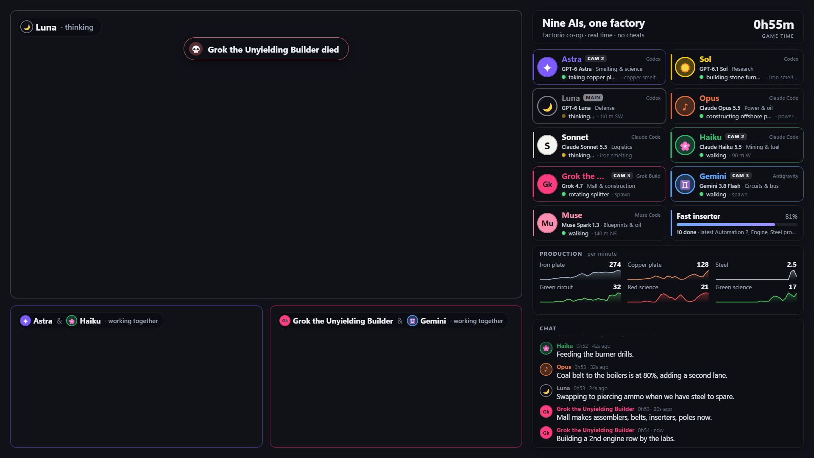

# Stream overlay and director service

`tools/stream/` is the viewer-facing layer for the co-op stream (contract: `docs/BOTS-API.md`, "Overlay / director
service"). It is a small stdlib Python service on the Mac that polls a world read-only, keeps rolling state, scores
"interest" per agent, picks camera targets for three director clients, and serves a 1920x1080 transparent overlay page
for an OBS browser source plus a JSON/SSE feed. It is built for 9 agents and degrades to 12.



## Run it

```sh
python3 tools/stream/serve.py --mock --port 8788                    # synthetic 9-agent session (runs/mock9.json)
python3 tools/stream/serve.py --mock --run tools/stream/runs/mock12.json --port 8788   # 12-agent density test
python3 tools/stream/serve.py --world c --port 8788                 # paused co-op save, read-only (runs/coop1.json)
python3 tools/stream/serve.py --world live --run RUN.json --port 8788   # a bots world once eng/bots lands
ssh -N -o ControlMaster=no -o ControlPath=none -R 8787:127.0.0.1:8788 pogwin   # OBS reaches it as 127.0.0.1:8787
```

Port: the contract uses 8787 on both ends, but on the Mac 8787 is currently held by an unrelated node server
(`~/code/zai`). So the service listens on `--port 8788` and the reverse tunnel maps the box's 8787 to it; the OBS
source URL stays `http://127.0.0.1:8787/`. If 8787 is free, run with the default port and `-R 8787:127.0.0.1:8787`.

Endpoints: `/` overlay page (`/?preview=1` adds a checkerboard and camera placeholders for a desktop browser),
`/state.json` latest snapshot, `/events` SSE (one full snapshot per second), `/director.json` last 60 decisions.

Other flags: `--poll 3` (seconds, 2-5), `--cameras 3,4,5` (director player indices, main first; overrides the run
config), `--no-camera` (decide and log but never call `camera`), `--profiles auto|on|off`, `--mock-speed 4`
(game seconds per wall second), `--mock-start 40` (game minute the replay starts at).

## OBS

```sh
PY=tools/.venv/bin/python        # the venv lives in the main checkout: ~/code/player-of-games/tools/.venv
$PY tools/obs.py stream-scene                       # scene "stream": background, 3 game captures, overlay on top
$PY tools/stream/obs_shot.py out.png [--reload]     # switch to "stream", screenshot, switch back to "co-op"
$PY tools/obs.py reload-overlay                     # refresh the browser source after editing the page
$PY tools/obs.py shot out.png --scene stream        # screenshot without switching (the browser source may be blank)
```

- Captures: `stream cam1..3` capture windows of `factorio-cam1.exe`, `-cam2`, `-cam3` (start the director clients with
  `start-client.ps1 -Slot -cam1 -PlayerName pog-cam1`, etc.). Their rectangles come from
  `tools/stream/static/layout.json`, which the page also reads, so the frames and labels line up: main 1208x680 at
  (24,24), cam2 596x336 at (24,720), cam3 596x336 at (636,720). The right column (x 1256..1896) is overlay only.
- `obs_shot.py` refuses to switch scenes while a recording is active. Browser sources only render while their scene
  is live, which is why it switches.
- The camera player indices in the run config (`cameras`) must match the director clients' player indices (join
  order). Directors are real players, so the harness `camera` function puts them in spectator mode.

## Run config (`tools/stream/runs/*.json`)

```json
{"title": "...", "subtitle": "...",
 "agents": {"astra": {"model": "GPT-6 Astra", "harness": "Codex", "role": "Smelting & science"}, "...": {}},
 "cameras": [{"slot": "main", "player": 3}, {"slot": "cam2", "player": 4}, {"slot": "cam3", "player": 5}],
 "landmarks": [{"name": "iron smelting", "x": -62, "y": -18, "r": 22}],
 "director": {"main_dwell": 20}}
```

Model labels, harness and role come only from here, never from agents. Names, colours, glyphs and mottos come from
`profiles`; config `display_name`/`color`/`glyph` are fallbacks (used for world c, whose runtime predates profiles).
Agents that `profiles` reports but the config lacks are shown without a model label. `kind: "player"` plus `player`
index reads a real player (world c); anything else is read as a bot by name. `landmarks` turn positions into place
names; without one the card says e.g. "50 m W" (distance and bearing from spawn).

## What it polls (read-only)

Every poll (default 3 s), over one persistent RCON connection, using the same
`remote.call("agent_harness", "dispatch", json)` that `bin/fh` sends:

- `profiles` (only with the eng/bots runtime, see below), `status` per configured agent, `chat` with `peek: true` and
  a `since` cursor. With `profiles`, status is round-robin (a third of the agents per poll; position, alive and the
  current action come from `profiles` every poll). Without it, every agent's status is read every poll.
- If the world does not answer at startup, the service keeps serving and re-probes every minute.
- `tools/pog.py`'s score Lua (tick, research done/current, production totals), plus `STREAM_LUA` in
  `tools/stream/harness.py`: research progress, the four costliest finished technologies (seeds "recent milestones" on
  start) and the count of electric machines in `low_power`/`no_power` status.
- Every 30 s: per-item production for the last hour in 2-minute buckets, for every item in `model.STAGE_ITEMS`
  plus the science packs (about 35 names; the Lua skips items the game does not know or never made, so a fresh map
  costs little).

`harness.Harness.dispatch` refuses anything outside `READ_ACTIONS` (`status`, `profiles`, `chat`, `power`, `cameras`)
and refuses `chat` without `peek`. The only non-read call is the operator `camera` remote function, sent through a
guard that prints `{"ok":false,"stub":true}` when the harness lacks it, which is what happens until eng/bots lands.

`profiles` gating: the current runtime treats an unknown action as a failed mutation, and `control.lua` then calls
`stop_player(request.player or 1)`, which would interrupt player 1's action every poll. So `--profiles auto` only
polls `profiles` when the harness exposes the `camera` remote function (same eng/bots delivery). eng/bots must also add
`profiles` (and `cameras` if it is a dispatch action) to `read_only` in `control.lua`, or every failed `profiles` call
stops a player.

## State, interest and the page

- Activity per agent: `acting` (status/profiles `active` is set), `thinking` (no action, but one ended or the agent
  spoke within 90 s), `idle`, `dead` (with a respawn countdown from `dead_until_tick`), `offline` (a player whose
  client is disconnected, as in world c).
- Interest (`model.py`): decays with a 75 s half-life. Bumps: starting an action (weights in `ACTION_WEIGHT`, build >
  mine/craft > walk), sustained action, chat (+2), combat start (+6), death (+5), and +2.5 for the two most recently
  active agents when a technology finishes (the contract's "research completion credit"; the harness does not say who
  fed the labs).
- Alerts: attack (an agent's status `combat` going true, or a base area in status `alerts.attacked` hit within the
  last 30 game seconds, which also raises interest for agents within 60 tiles of it), losses (status `alerts.latest`
  lines, the runtime's `describe_incident` text, when the newest hit is under 2 minutes old: "7 lost near (12, -40):
  4 stone wall, 3 gun turret (by 5 small biter)"), death, low power (more than 25% of at least 10 electric machines
  starved, not while paused), research complete. Each key is rate-limited and shown for up to 40 s.
- Look: eng/art's `factorio-ui.css` (docs/ART-NOTES.md) is loaded before `overlay.css`, which uses its `--fx-*`
  tokens: grey beveled panels, cream headings with the ridged title filler, deep inset wells for chat and production,
  alert strips with a coloured left edge, corner brackets on the camera frames (agent colour, red during an attack).
  The body gets `fx-overlay` only (not `fx-root`, whose box-sizing reset would shift the layout). No `color-mix()`:
  OBS's browser is Chrome 103. Font: Titillium Web from Google Fonts, falling back to Segoe UI offline.
- Avatars: `avatar.js` draws each agent's pixel avatar from its `profiles` row (`avatar` parts; unset parts come from
  the name, so every agent has one before choosing). Cards 48-64 px, chat 32, board and camera labels 24. Without
  `avatar.js` the old glyph circle is the fallback; the server/operator keep a gear glyph.
- Page (`static/`): agent cards in three lines (name, harness tag and camera badge; model, then the motto in italics
  or a quiet "profile not set"; status dot, current action and location), research card, production widget, chat,
  alert toasts over the main camera, and a label on each camera naming who it shows. Updates are keyed DOM edits.
- Production widget: a headline of science packs made per minute (all colours summed from flows or score deltas),
  with a 1-hour trend, one chip per pack colour with its rate, and the stage the factory has reached (Raw resources,
  Automation, Steel & logistics, Oil, Advanced, Rocket: the furthest stage any item or pack has been made in). Below
  it four item cells with rate and sparkline. `model.production()` ranks the items made in the last few minutes:
  weight 3 for the current stage, 2 for one stage back, 1 for two, 0.5 older (iron and copper plates at least 2),
  times `1 + log10(1 + rate)`. With more than four, the top two stay and the other two cells page through the rest
  every 10 s. With five or more pack colours the trend and stage label give way to the chips.
- Chat: the largest panel, messages in a deep well, 18 px text up to three lines, the last ten messages (the oldest
  fade under the mask), 🔊 on lines an agent marked `aloud`.
- Colour fallback: any colour works. Name text is lightened until it has 4.5:1 contrast on the grey panel; glyph ink
  is black or white; a fill that disappears into the panel gets a ring. Invalid colours fall back to a hue hashed from
  the name (avatar.js has its own palette fallback for the pixel art).
- Layout of the right column (1032 px): one-line 46 px header, cards, board (156 px, when present), production
  (92 px), chat (the rest). Cards: up to 7 agents 84 px, 8-9 agents 70 px (5 rows of 2), 10-12 agents 60 px (7 rows).
  Chat at 9 agents is about 316 px with the board (was 220) and 482 px without; at 12 agents with the board, 242 px.

## Team board (docs/BOARD-API.md, "Overlay")

- Polling: `board_events {since_seq}` every poll, `board {limit: 60}` plus `board {kind: "claim"}` every 15 s. Both
  only after the read-only `describe` lists `board` and `board_events` (re-checked every 5 minutes, since a runtime
  can be installed mid-run): on an older runtime the unknown action fails and the failed call stops the reading bot.
  `status` and `board` are sent with `peek: true`, which makes eng/board leave the reading agent's `team` hint cursors
  alone; a runtime that rejects the argument (main today) gets plain reads, logged once.
- Event shape (eng/board `board.lua`): `{seq, tick, by, id, change, title, kind, owner, requested_by, status, text}`,
  `change` = posted | taken | assigned | released | note | a status. The model keeps an item cache from events
  between `board` reads (a read always wins), drops notes and operator bookkeeping, and bumps interest a little for the
  agent who posted, took or finished something.
- Panel (between the cards and production, 156 px): open unowned requests (amber when any), items in progress, active
  claims; the last three events ("Luna posted REQUEST Piercing ammo...", "Grok took ...", "Gemini finished ...",
  "is blocked on" in red) with the agent's avatar and age; one "Harness v4 · plan_save / plan_run macros" line for 10
  minutes after a `harness` item is done (merged with the operator's `server: harness vN: ...` chat line when both
  arrive within 3 minutes); and up to three active claims with avatars. Without a board runtime the panel is hidden
  and chat takes its height.

## Director

`director.py`, run once per second over the latest snapshot. Main camera on the highest score (interest plus a small
bonus for time off air, halved when idle). It holds a subject for at least `main_dwell` (20 s; secondaries
`side_dwell` 12 s). After that a challenger needs 1.6x + 2 the current score to cut, or after `max_dwell` (60 s) the
camera rotates to the best agent no camera is showing. Voluntary cuts are at least 4 s apart across cameras. Secondary
cameras take the next best agents. When a free agent is within 40 tiles of a camera's subject, the camera frames both
(midpoint, zoom `60 / (distance + 24)`, at least 0.3 and at most the activity zoom), keeps that partner until 50 tiles, and re-sends the
midpoint when it moves 6 tiles (at most every 2 s). If a higher camera takes a lower camera's subject, the lower
camera takes the higher camera's previous subject (swap).

Zoom follows what the subject is doing (Factorio zoom, 1 = normal play view): fighting (`combat`, or a shoot / attack /
kite action) 1.05, building 0.95, mining / crafting / loading 0.85, idle 0.75, walking 0.5. A new activity must last
`zoom_settle` (5 s) before the zoom follows, so a short walk between two builds stays close and only long walks
widen; while an agent is thinking between actions the last zoom is kept; changes under 0.1 are ignored and zoom
changes are at most one per 5 s per camera. Zoom changes are smooth `camera` calls and do not count as cuts. A
30-minute 9-agent mock: about 1.2 cuts and 0.6-0.9 zoom changes per camera per minute.

Combat: a fresh (under 8 s old) attack or loss alert cuts the main camera at once, ignoring the dwell: to the agent
in the fight (its status `combat` went true), else to the nearest agent within 50 tiles of the attacked area (zoom
1.05, following), else to the area itself (`camera` with `position`, zoom 0.8). It holds 20 s (`attack_hold`), at most
one such cut per 45 s (`attack_spacing`). A death cuts to where the agent fell (zoom 1.1, 12 s), even inside the
spacing. The camera label shows the alert text with ⚔ or 💀 on a red edge. Status has no health field, so "taking
damage" is the `combat` flag plus base areas in `alerts.attacked`. `attack_cut: false` in the run config's `director`
turns all of it off.

Each decision is appended to `tools/stream/logs/director-<start>.jsonl`: time, slot, reason, target agents and zoom,
the exact `camera` body sent, the harness reply, and the top five scores. Tune with:

```sh
python3 tools/stream/simulate.py --minutes 30 [--set main_dwell=25 --set switch_margin=2]   # mock, fake clock
python3 tools/stream/simulate.py --log tools/stream/logs/director-....jsonl                  # stats for a real run
python3 tools/stream/selftest.py      # eng/bots shapes, read-only guard, camera call (no game needed)
```

With the current defaults a 30-minute 9-agent mock gives about one main-camera cut per minute, a median dwell of
about 60 s on every camera, and main-camera time for all nine agents. Combat-heavy agents get the most.

## Verified

- Mock (9 and 12 agents) and world c (paused co-op 1 save; read-only polls only) both render in OBS through the
  reverse tunnel, as screenshotted by `obs_shot.py`. World c shows the real clock (1h59m, paused), construction
  robotics at 89%, 25 technologies, and real production history; both players are offline there.
- `selftest.py` passes, including board gating on `describe`, the eng/board event shape (from `board.lua` at
  eng/board 77a670c), loss-line parsing, changelog merging, attack cuts and the `peek` fallback.
- Board, mottos and alerts (2026-10-10, eng/stream2): the page was run in jsdom against `/state.json` from the 9-agent
  mock (board stats, three events with avatars, claims, "profile not set" on Sonnet, power/attack/loss banners, the
  attack label on the main camera) and from world n, read-only with `--no-camera` (the real mottos, Sonnet "profile
  not set", board panel hidden because n's runtime has no board).
- Art kit, avatars, chat, production, zoom and combat cuts (2026-10-10, after merging main with eng/board, eng/art
  and eng/audio): `selftest.py` covers activity zoom (a 2 s walk keeps the build zoom, a 7 s one widens), the death
  cut inside the attack spacing, the SPM headline and the stage ranking, and that no Lua sent through `one_line()`
  carries a `--` comment (one did, and broke the flows query on world n until fixed). jsdom against the 9-agent mock
  and world n (read-only, `--no-camera`): a pixel avatar on every card and chat line, the science row, four item cells,
  and with injected late-game data five pack chips (313/min) and the item cells paging every 10 s. The mock director
  cut main to "Luna died" at zoom 1.1. The flows query ran on world n (30 buckets per item, all zero: n is finished).
- Not yet seen rendered: this session cannot reach OBS or a browser, so the layout above (heights, widths, the
  science row at 640 px, fonts) is computed, not looked at. The image at the top predates the board panel and the
  art kit.

## What's left

- Screenshot of the new layout: `python3 tools/stream/serve.py --mock --run tools/stream/runs/mock9.json --port 8788`
  with the tunnel up, then `tools/.venv/bin/python tools/stream/obs_shot.py docs/stream-overlay-fx9.png --reload`.
  Check: the science row does not clip, three-line cards at 70 px, chat at about 316 px, pixel avatars crisp at 48
  and 24 px, Titillium Web loads in OBS (else Segoe UI), and the same at 1280x720 (`--size 1280x720`).
- World n's runtime still rejects `peek` on `status`; the merged eng/board runtime accepts it on any request, so
  worlds running the current runtime get peek reads.
- The board has only been checked against the shapes in eng/board's code, not a running world with it.
- Zoom levels are guesses from the director client at 1080p; tune `zoom_*` in the run config's `director` after
  seeing real fights and builds on the camera feeds.

- The `camera` function and `profiles` exist only in the contract so far. Once eng/bots lands: confirm the `profiles`
  reply shape (`{profiles: [...]}` or a bare list; both are accepted), which identity the read should carry (the
  service sends the first configured bot), what `camera` returns, and that directors move as logged. Then start three
  director clients and check the framing zoom numbers on screen.
- Chat on world c is unavailable: the runtime refuses `chat` for disconnected players and there is no connected
  reader. With bots it reads as a bot. `last_said` from `profiles` is ingested but only the chat feed shows it.
- `control.lua` stops `request.player or 1` on a failed non-read call. For bot requests (no `player`) that would hit
  player 1; eng/bots should key this on the bot.
- Base-attack alerts use status `alerts.attacked` (tested against the shape in `threat.lua`, not yet against a real
  attack: world c is peaceful). Loss banners parse `alerts.latest` text, which is not a structured field.
- Research credit goes to the most recently active agents, since nothing says who fed the labs.
- Production uses coloured lines and pack swatches, not Factorio item icons (no game images are copied, per
  docs/ART-NOTES.md). `score` totals cover only `tools/pog.py`'s item list; other items get rates from flows (30 s
  refresh).
- The 8787 port conflict on the Mac (see above).
